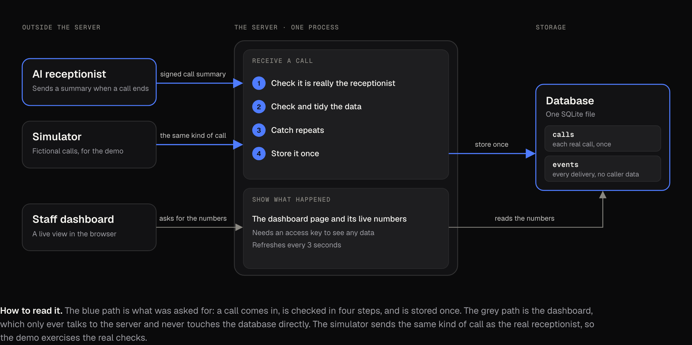

# Call summary webhook

An endpoint that receives the summary an AI receptionist sends after a call (caller name, phone, reason for calling, requested time), validates it, drops duplicates and stores it in SQLite. Next.js (App Router) and TypeScript.

It also has a small dashboard and an architecture page, so the data can be looked at. Everything in the demo is made-up sample data.


## Run it

Needs Node 22.13 or newer.

```sh
npm install
npm run demo
```

Open the Local URL it prints. There is no login in demo mode. It seeds 30 days of fictional history and keeps sending new calls while you watch. The buttons on the dashboard send a call, a duplicate, a bad payload or a forged one through the real endpoint.

To run it for real:

```sh
cp .env.example .env.local   # set WEBHOOK_SECRET, and DASHBOARD_TOKEN if you want the dashboard
npm run dev
```

| Variable | |
| --- | --- |
| `WEBHOOK_SECRET` | Required, 16+ characters. Used to sign request bodies. |
| `DASHBOARD_TOKEN` | Turns on the dashboard and its data endpoint outside demo mode, 16+ characters. Off when empty. |
| `DASHBOARD_TZ` | Timezone the dashboard counts days in. Default `America/New_York`. |
| `DATABASE_PATH` | SQLite file. Default `./data/calls.db`. |

## The endpoint

`POST /api/webhooks/call-summary`

The sender signs the raw body with the shared secret and sends the result in `X-Webhook-Signature: sha256=<hex>` (HMAC-SHA256).

```sh
BODY='{"call_id":"call_001","caller_name":"Jane Sample","phone":"(555) 010-0123","reason":"Routine check-up","requested_time":"2026-12-01T09:00:00-05:00"}'
SIG="sha256=$(printf '%s' "$BODY" | openssl dgst -sha256 -hmac "$WEBHOOK_SECRET" | awk '{print $NF}')"

curl -i -X POST http://localhost:3000/api/webhooks/call-summary \
  -H "content-type: application/json" -H "x-webhook-signature: $SIG" -d "$BODY"
```

| Field | Rules |
| --- | --- |
| `caller_name` | Required, up to 100 characters. Whitespace is collapsed. |
| `phone` | Required. Stored as E.164. A number without `+` must be a 10-digit US/CA number. |
| `reason` | Required, up to 1000 characters. |
| `requested_time` | Required. ISO 8601 with a timezone or offset. Stored in UTC. |
| `call_id` | Optional, up to 128 characters. The sender's own id for the call. |

Other fields are ignored.

| Status | Body | Meaning |
| --- | --- | --- |
| 201 | `{"status":"created","id":"..."}` | Stored. |
| 200 | `{"status":"duplicate","id":"...","matched_on":"call_id"}` | Already had it. `matched_on` is `call_id` or `slot`. |
| 400 | `{"status":"invalid_json"}` | Signed, but not JSON. |
| 401 | `{"status":"unauthorized"}` | Missing or wrong signature. |
| 413 | `{"status":"too_large"}` | Body over 64 KB. |
| 422 | `{"status":"invalid","errors":[{"field","message"}]}` | Failed validation. Errors never repeat the submitted value. |
| 500 | `{"status":"error"}` | Storage failed. The sender should retry. |

A duplicate is a 200 on purpose. Webhook senders retry anything that isn't a success, so an error would only make them send it again.

## Duplicates

A call is a duplicate if it has the same `call_id`, or the same phone number asking for the same time slot. Name and reason are left out of the second rule because speech-to-text spells names differently from call to call and a summary is never worded the same way twice.

The check and the insert are one statement (`INSERT ... ON CONFLICT DO NOTHING` against two `UNIQUE` columns), so two identical requests arriving together can't both be stored. There is a test that fires 20 at once.

## Dashboard

`/` shows counts per day, duplicates blocked, a live feed, requested appointment times and a searchable table. In demo mode it opens straight away. On a real server it needs `DASHBOARD_TOKEN` and asks for it on first load, because it lists caller names and numbers. Phone numbers are masked until you switch them on.

`/architecture` explains how it fits together:



## Tests

```sh
npm test         # vitest
npm run check    # lint, typecheck and tests
```

Over 350 tests: validation edge cases, the handler with every status code, concurrent duplicates, restart persistence, dashboard counting across daylight-saving changes, config, the CSP, the simulator, and server-rendered components.

## Layout

```
app/
  api/webhooks/call-summary/   the endpoint
  api/dashboard/               dashboard data, behind the token
  api/demo/simulate/           demo mode only
  architecture/                architecture page
  page.tsx                     dashboard
lib/
  handlers/                    request logic, plain Request in and Response out
  schema.ts  signature.ts  store.ts  dashboard.ts  config.ts
  demo/                        simulated receptionist and seed data
components/dashboard/          dashboard UI
proxy.ts                       per-request Content-Security-Policy
__tests__/
```

The handlers in `lib/handlers` don't import anything from Next, which is why they can be tested directly and moved to another server if needed.

## Notes

- The brief doesn't say how the platform authenticates, so signing the body with a shared secret is my assumption. It lives in `lib/signature.ts`.
- SQLite needs a disk that persists. On a serverless host, swap `CallStore` for Postgres and keep the same two unique keys.
- `node:sqlite` is still marked experimental in Node 22, so the npm scripts silence that warning.
