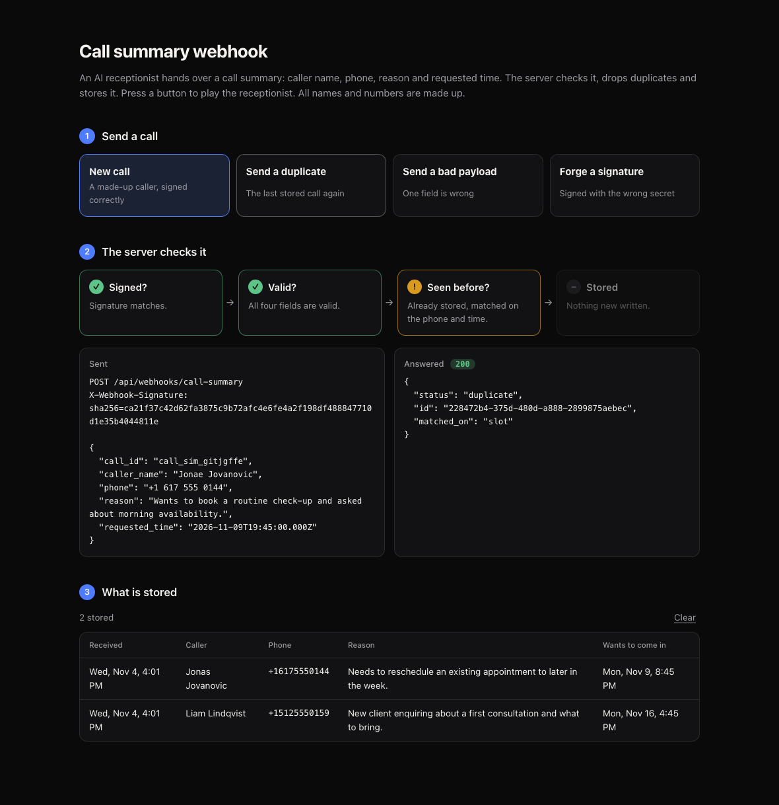

# Call summary webhook

An endpoint that receives the summary an AI receptionist sends after a call (caller name, phone, reason for calling, requested time), validates it, drops duplicates and stores it in SQLite. Next.js (App Router) and TypeScript.



## Run it

Needs Node 22.13 or newer.

```sh
npm install
npm run demo     # the endpoint plus a page to try it
npm test         # about 250 tests; npm run check also runs lint and typecheck
```

Open the Local URL it prints. The page plays the receptionist: each button sends a signed request to the real endpoint and shows the request, the answer and which check stopped it. The list at the bottom is what is in the database. It starts with four sample calls, and a request sent from a terminal shows up there too. All names and numbers are made up.

To run only the endpoint, copy `.env.example` to `.env.local`, set `WEBHOOK_SECRET` (16+ characters) and run `npm run dev`. The demo page and its `/api/demo/*` routes exist only when `DEMO_MODE=1`, so a real server has the webhook and nothing that reads stored calls back. `DATABASE_PATH` changes where the SQLite file lives (default `./data/calls.db`).

## The endpoint

`POST /api/webhooks/call-summary`

The sender signs the raw body with the shared secret and sends the result in `X-Webhook-Signature: sha256=<hex>` (HMAC-SHA256). The demo secret is `demo-webhook-secret-0123456789`.

```sh
BODY='{"call_id":"call_001","caller_name":"Jane Sample","phone":"(555) 010-0123","reason":"Routine check-up","requested_time":"2026-12-01T09:00:00-05:00"}'
SIG="sha256=$(printf '%s' "$BODY" | openssl dgst -sha256 -hmac "$WEBHOOK_SECRET" | awk '{print $NF}')"

curl -i -X POST http://localhost:3000/api/webhooks/call-summary \
  -H "content-type: application/json" -H "x-webhook-signature: $SIG" -d "$BODY"
```

| Field | Rules |
| --- | --- |
| `caller_name` | Required, up to 100 characters. |
| `phone` | Required. Stored as E.164. Without a `+` it must be a 10-digit US/CA number. |
| `reason` | Required, up to 1000 characters. |
| `requested_time` | Required. ISO 8601 with a timezone or offset. Stored in UTC. |
| `call_id` | Optional. The sender's own id for the call. |

| Status | Meaning |
| --- | --- |
| 201 | Stored. |
| 200 | Duplicate. Nothing new stored; the body has the original `id` and `matched_on` (`call_id` or `slot`). |
| 400 / 422 | Not JSON, or failed validation. 422 lists the failing fields and never repeats their values. |
| 401 | Missing or wrong signature. |
| 413 | Body over 64 KB. |
| 500 | Storage failed. The sender should retry. |

A duplicate is a 200 on purpose: webhook senders retry anything that isn't a success, so an error would only make them send it again.

## Duplicates

A call is a duplicate if it has the same `call_id`, or the same phone number asking for the same time slot. Name and reason are left out of the second rule because speech-to-text spells names differently from call to call and a summary is never worded the same way twice.

The check and the insert are one statement (`INSERT ... ON CONFLICT DO NOTHING` against two `UNIQUE` columns), so two identical requests arriving together can't both be stored. A test fires 20 at once.

## Layout

```
app/api/webhooks/call-summary/   the endpoint
app/api/demo/                    demo only
app/page.tsx, components/        the demo page
lib/handlers/                    request logic, plain Request in and Response out
lib/schema.ts signature.ts store.ts
__tests__/
```

## Notes

- The brief doesn't say how the platform authenticates, so signing the body with a shared secret is my assumption. It lives in `lib/signature.ts`.
- SQLite needs a disk that persists. On a serverless host, swap `CallStore` for Postgres and keep the same two unique keys.
- `node:sqlite` is still marked experimental in Node 22, so the npm scripts silence that warning.
