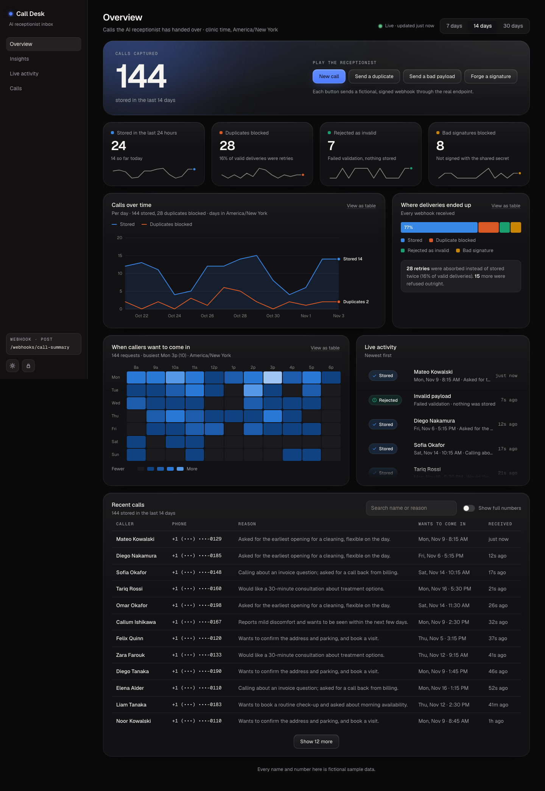
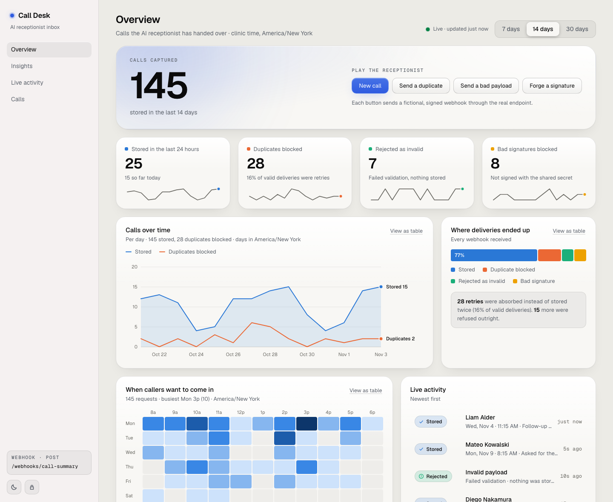

# Call Summary Webhook

A small API endpoint that receives an AI receptionist's call summary as a webhook, **validates** it, **prevents duplicates** and **stores** it, plus a live **dashboard** to see what came in.

TypeScript · [Hono](https://hono.dev) · [zod](https://zod.dev) · SQLite (Node's built-in `node:sqlite`, so no native build step) · tests with `node:test`.



> All data in this repo (tests, examples, the demo) is fictional: invented names and phone numbers from the 555-01xx block reserved for fiction. Nothing here uses real people or real patient information.

## Run it

Requires Node **22.18+**.

```bash
npm install
npm run demo      # dashboard + a simulated receptionist, nothing to configure
npm run check     # typecheck + all tests
```

`npm run demo` prints a link like `http://localhost:3000/#key=…`. Open it and calls start arriving every few seconds. It runs the **real** server on a throwaway demo database seeded with 30 days of made-up history, and a simulated receptionist posts signed webhooks to the real endpoint, including the odd retry, bad payload and forged signature. The buttons at the top of the page do the same on demand.

For the real thing:

```bash
cp .env.example .env     # set WEBHOOK_SECRET (and DASHBOARD_TOKEN to turn the dashboard on)
npm start                # http://localhost:3000
npm run simulate -- --interval 3000 --count 20   # optional: play the receptionist against it
```

## The endpoint

`POST /webhooks/call-summary`

```json
{
  "call_id": "call_sample_0001",
  "caller_name": "Jane Sample",
  "phone": "(555) 010-0123",
  "reason": "Would like to book a routine check-up.",
  "requested_time": "2026-11-10T09:00:00-05:00"
}
```

| Field | Rules |
| --- | --- |
| `caller_name` | required, 1-100 chars, whitespace collapsed |
| `phone` | required, normalised to E.164. `+`-prefixed numbers must be valid E.164; a bare 10-digit number is assumed US/CA (`+1`); anything else is rejected, not guessed |
| `reason` | required, 1-1000 chars |
| `requested_time` | required, ISO 8601 **with a timezone** (`Z` or an offset), stored as UTC. A bare `3pm` or `2026-11-10T15:00` is rejected because it's ambiguous |
| `call_id` | optional, the platform's own id for the call. Strongest duplicate key when present |

Unknown fields are ignored (and not stored).

### Authentication

Every request must carry `X-Webhook-Signature: sha256=<hex>`, the HMAC-SHA256 of the **raw request body** keyed with `WEBHOOK_SECRET`. It is checked in constant time before the body is parsed. To try it by hand:

```bash
BODY='{"call_id":"call_sample_0001","caller_name":"Jane Sample","phone":"(555) 010-0123","reason":"Would like to book a routine check-up.","requested_time":"2026-11-10T09:00:00-05:00"}'
SIG="sha256=$(printf '%s' "$BODY" | openssl dgst -sha256 -hmac "$WEBHOOK_SECRET" | awk '{print $NF}')"
curl -i -X POST localhost:3000/webhooks/call-summary -H "x-webhook-signature: $SIG" -d "$BODY"
```

### Responses

| Status | Body | Meaning |
| --- | --- | --- |
| `201` | `{"status":"created","id":"…"}` | Stored |
| `200` | `{"status":"duplicate","id":"…","matched_on":"call_id"\|"slot"}` | Already had it; nothing written. Returns the original id |
| `400` | `{"status":"invalid_json"}` | Signed, but not JSON |
| `401` | `{"status":"unauthorized"}` | Missing or wrong signature |
| `413` | `{"status":"too_large"}` | Body over 64 KB |
| `422` | `{"status":"invalid","errors":[{"field","message"}]}` | Failed validation; every bad field listed. Messages never echo the submitted values |
| `500` | `{"status":"error"}` | Storage failure. The sender should retry |

A duplicate is a **200, not an error**: webhook senders retry anything non-2xx, so rejecting a replay would only make them retry again. `4xx` means "retrying these bytes can't help", `5xx` means "please retry".

`GET /health` returns `{"status":"ok"}`.

## How duplicates are prevented

A call is a duplicate if **either** is true:

1. it has the same `call_id` as a stored call (the platform re-sent the webhook), or
2. it has the same **normalised phone + requested time (as a UTC instant)** (the same person asking for the same slot, whether it's a retry or a second call).

`(555) 010-0123` and `+1 555 010 0123`, or `09:00-05:00` and `14:00Z`, count as the same.

- **The check is the insert.** Both rules are `UNIQUE` constraints and the write is `INSERT … ON CONFLICT DO NOTHING`, so there is no check-then-insert race. Parallel deliveries (even from several processes) store exactly one row. There's a test firing 20 at once.
- **Name and reason are deliberately not in the key.** Speech-to-text spells the same person differently ("Jon"/"John") and an LLM never words a summary the same way twice, so including them would let real duplicates through.
- **Trade-off:** two different people phoning from one number for the same slot collapse into one record. For an appointment-request inbox I judged a duplicate slot request worse than that edge case; the response says `duplicate` + the original id, so nothing fails silently. If the platform always sends a reliable `call_id`, drop rule 2 in `src/store.ts`.
- Replays of a captured, validly-signed request are harmless for the same reason, so there is no timestamp/nonce scheme.

## The dashboard



Served at `/` by the same process, no build step, no dependencies in the browser. Set `DASHBOARD_TOKEN` (16+ characters) to switch it on; without it the data API answers 404 and the page says the dashboard is switched off.

| What | Chart | Why this form |
| --- | --- | --- |
| Calls captured, last 24 h, duplicates / invalid / bad signatures blocked | hero figure + stat tiles with sparklines | single numbers, so no chart |
| Calls over time | line + area, crosshair tooltip | trend over time |
| Where deliveries ended up | tall segmented bar | one whole split into four parts |
| When callers want to come in | weekday × hour heatmap (clinic time) | magnitude on a grid |
| Live activity | feed, newest first | |
| Recent calls | searchable table | |

- **One date filter** (7/14/30 days) scopes every number on the page. The page polls every 3 s and keeps the previous render on screen while it reloads.
- **Every chart has a "View as table"** twin (the accessible route to every number, including the heatmap's); the line chart (arrow keys) and the bar (tab) show their tooltips on keyboard focus too; dark and light themes.
- **Outcomes keep one colour everywhere** (stored = blue, duplicate = orange, invalid = green, bad signature = amber). The palette passes the validator's colour-blind separation checks in both themes. Three light-theme hues sit just under 3:1 contrast on the card, so those charts also carry a legend, direct labels or in-bar labels, and the table view.
- **Days are counted in the clinic's timezone** (`DASHBOARD_TZ`, default `America/New_York`), not UTC, so "today" matches the clock on the wall.
- **Data behind it:** every delivery, whatever its outcome, is logged to an `events` table with no caller data (that stays in `calls`). That's what makes "duplicates blocked" countable. Old events are pruned past 20,000.

### Dashboard security and privacy

The page shows caller details, so:

- the page and assets hold no data; `GET /api/dashboard` needs `Authorization: Bearer <DASHBOARD_TOKEN>` (constant-time compare). The token can be passed as `/#key=…`; a URL fragment is never sent to the server, and the page strips it from the address bar;
- phone numbers are masked in the table until you flip "Show full numbers". **That is a display convenience, not access control**: the API returns full numbers to anyone with the token;
- caller-supplied text is only ever rendered with `textContent`, never as HTML (a test fails the build if `innerHTML` and friends appear in the script), on top of a strict Content-Security-Policy (`script-src 'self'`, `frame-ancestors 'none'`);
- `npm run demo` uses fixed, public, throwaway credentials. Never expose it to a network.

### The simulator

`src/simulator.ts` plays the AI receptionist: fictional callers, retries (byte-for-byte, and "same slot, re-spoken"), malformed payloads and forged signatures. It's used by `npm run demo`, `npm run simulate` and the dashboard's buttons, and the tests check that it only ever invents valid calls from the fictional phone block, that its duplicates are really recognised and its bad payloads really rejected.

## Layout

```
src/schema.ts      validation + normalisation (zod)
src/signature.ts   HMAC sign/verify
src/store.ts       SQLite storage, duplicate rule, delivery events
src/app.ts         the HTTP endpoints (status-code policy lives here)
src/dashboard.ts   the numbers behind the dashboard, bucketed by clinic day
src/assets.ts      allow-listed static files for the dashboard
src/simulator.ts   the fictional receptionist
src/seed.ts        30 days of believable made-up history
src/demo.ts        `npm run demo`
src/simulate.ts    `npm run simulate`
src/server.ts      entry point (env, startup, graceful shutdown)
public/            the dashboard: index.html, dashboard.css, dashboard.js, Geist fonts (OFL)
test/              75 tests: schema, signing, dedupe (incl. concurrency + restart), dashboard maths
                   (timezones, DST), API auth, demo endpoint, static-file safety, simulator
```

## Notes and next steps

- **Privacy:** caller name, phone and reason are personal data. Logs record only outcome, id and field *names*, never values (there's a test for it). In production I'd also encrypt the database at rest and add a retention policy.
- **Storage:** a SQLite file needs a persistent disk (a VM, Fly volume, etc.). On serverless platforms with ephemeral disks, swap `CallStore` for Postgres, keeping the same two `UNIQUE` constraints; the rest of the app is unchanged. The dashboard aggregates in JS over the selected window (fine for an appointment inbox); at much larger volume, move the `GROUP BY` into SQL.
- **Dashboard tests:** the server side is covered by tests; the page itself was checked by hand in a real browser (dark/light, mobile, XSS payload), not by an automated browser test.
- **Not built (out of scope for a few hours):** per-user dashboard login and rate-limiting of token guesses (one shared token today), secret rotation (accept two secrets), per-tenant secrets, real voice (an ElevenLabs agent could drive the same endpoint instead of the simulator).
